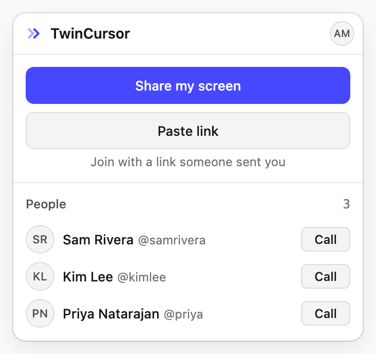
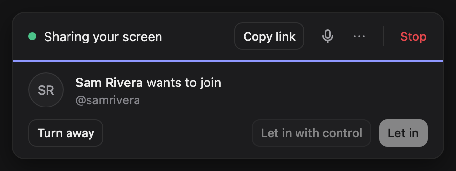
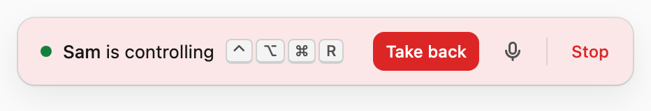

# TwinCursor

[](https://github.com/abhinavbolla/twincursor/actions/workflows/ci.yml)
[](LICENSE)

**Open-source remote pair programming.** Share your screen with sharp text and very little lag,
talk, and let your pair take the keyboard and mouse. Pairing over the internet should feel like
sharing a desk.

TwinCursor is a menu bar app for the Mac. Sign in with GitHub, click **Share my screen**, and
send the link that lands on your clipboard. Your pair pastes it and waits; you let them in, with
control if you like. People you've paired with stay in the panel, so next time you ring them.

<p>
  
</p>
<p>
  
</p>
<p>
  
</p>

> **TwinCursor is in early development.** The app works end to end but isn't signed by Apple yet,
> and there are no public builds. See [what works](#what-works-today) and
> [how to get it](#get-it).

## Why TwinCursor

The best pairing tools are closed and paid per seat, and general video calls blur code and lag
behind your hands. TwinCursor is built around three ideas:

- **Latency is the product.** All media runs in native Rust rather than a webview, and every change
  to that path has to report its effect on latency.
- **You stay in control of your machine.** A guest can only control your computer after you grant
  it. You can always see who is controlling it, and take it back instantly with ⌃⌥⌘R from any
  app. The [threat model](docs/threat-model.md) covers what's protected and what isn't.
- **It's yours to run.** It's AGPL-3.0, and you can run the whole service yourself.

## What works today

| | Status |
|---|---|
| Mac menu bar app: share, join by link, let people in, ring people you've paired with | Works; builds are unsigned |
| Sign-in with GitHub, contacts, call links | Works, on a Supabase backend |
| Screen sharing up to 4K, with HEVC at 4K | Works: Mac sharer; Mac viewer, or Windows viewer from the command line |
| Voice, with echo cancellation and mute | Works |
| Remote control, with trusted control for a call and a global revoke hotkey | Works (Mac sharer), in hands-on testing |
| Call health numbers, and auto-throttle on poor networks | Works |
| Self-hosting | A [guide](docs/self-hosting.md): your own Supabase project and LiveKit server |
| Windows app with sign-in, Linux, camera, end-to-end encryption | Planned |

The [roadmap](docs/ROADMAP.md) has the full plan.

## Get it

There are two ways to use TwinCursor:

- **A build from someone who runs a backend.** A TwinCursor app is built for one backend. If
  someone you pair with runs one, ask them for their build, and follow the
  [testing guide](docs/testing-guide.md) to install it.
- **Run your own.** Set up a Supabase project and a LiveKit server, and build the app pointed at
  them: [self-hosting](docs/self-hosting.md).

A build with no backend opens, but says it isn't connected to a server.

## Build from source

You'll need an Apple Silicon Mac with [Xcode 26](https://developer.apple.com/xcode/),
[Rust](https://rustup.rs) 1.90 or newer and [Node](https://nodejs.org) 20.19 or newer. The first
build downloads a prebuilt WebRTC library of about 277 MB.

```bash
git clone https://github.com/abhinavbolla/twincursor
cd twincursor
apps/desktop/scripts/package.sh ~/.config/twincursor/backend.conf
```

That writes `target/release/packages/TwinCursor-<version>-macos-arm64.dmg`. The backend file
holds your Supabase project's URL and public key ([example](apps/desktop/backend.example.conf));
leave it out to build an app with no backend. [Releasing](docs/RELEASING.md) has the details.

### The terminal tools

The engine also runs from the terminal, with no accounts, against a local LiveKit server. That is
how it's developed and measured:

```bash
brew install livekit
cargo build --release -p twincursor-media-spike
livekit-server --dev                    # in its own terminal
target/release/tc-spike share           # in another
target/release/tc-spike view            # and another
```

macOS asks to allow Screen Recording and the microphone for your terminal. Press `S` in the
viewer for the stats HUD, and see `tc-spike --help` for the options. The commands for remote
control, voice, the benches and the network lab are in [CLAUDE.md](CLAUDE.md#commands).

#### Between two machines

Start the server so that other machines can reach it with `livekit-server --dev --bind 0.0.0.0`,
share as above, and on the other machine point the viewer at the sharer's address:

```bash
target/release/tc-spike view --url ws://192.168.1.20:7880
```

`--dev` uses well-known keys and an unencrypted connection, so only do this on a network you
trust. To build the viewer on Windows, use the Rust MSVC toolchain and clone to a short path such
as `C:\tc`, because deep folders hit git's filename limit.

## Measured performance

| Measure | Result |
|---|---|
| 1080p between two machines on home Wi-Fi | 60 fps, round trip 29 ms typical, 105 ms at p95 |
| Text quality, H.264 | SSIM 0.9996 (1.0 is identical) at about 0.8 Mbps, even while scrolling fast |
| Sharer CPU, H.264 at 1080p | 14% of one core |
| Delay the input path adds | Under 1 ms on top of the network |

These come from one Apple M4 MacBook and one Windows laptop, and the
[performance page](docs/performance.md) has the full results, the 4K numbers and how to reproduce
them. They don't yet include the app's own redraw time, so they aren't full glass-to-glass
latency.

## How it works

The sharer captures the screen with ScreenCaptureKit and encodes it in hardware (H.264, or HEVC
at 4K). Video and voice go through a [LiveKit](https://livekit.io) server to a native viewer, and
remote-control input comes back over data channels. A [Supabase](https://supabase.com) backend
holds accounts and calls, and hands each person a short-lived pass for the one call they were let
into; it never sees the screen or the voice. Read the [architecture](docs/ARCHITECTURE.md) for the
details, and the [decision records](docs/adr) for why it's built this way.

## Contributing

Issues, measurements and pull requests are all welcome. Start with
[CONTRIBUTING.md](CONTRIBUTING.md), and look for a
[good first issue](https://github.com/abhinavbolla/twincursor/labels/good%20first%20issue). To ask a
question or share an idea, use [Discussions](https://github.com/abhinavbolla/twincursor/discussions).
Everyone taking part follows our [code of conduct](CODE_OF_CONDUCT.md).

Report security problems privately: see [SECURITY.md](SECURITY.md).

## License

TwinCursor is licensed under [AGPL-3.0](LICENSE). Contributions are accepted under a
[Contributor License Agreement](CLA.md).
